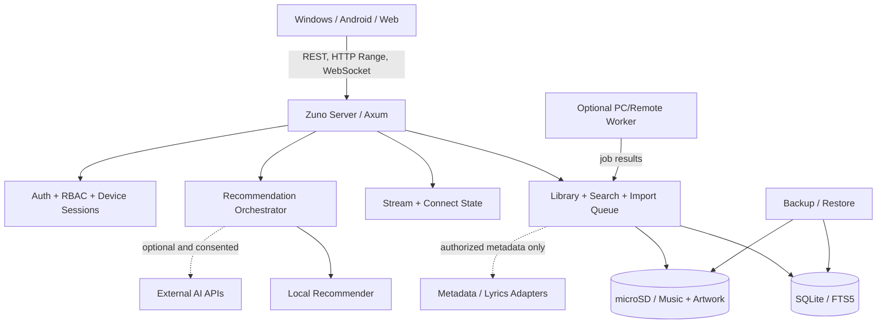
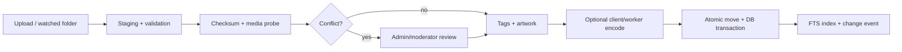

# Zuno — Product Requirements Document (PRD)

**Versão:** 2.0 (consolidação das oito etapas)  
**Data:** 25/10/2026  
**Status:** Baseline de produto; decisões pendentes explicitadas  
**Produto:** Streaming de músicas self-hosted, gratuito, open-source, multiusuário  
**Documentos relacionados:** `PLANO_AGENTE.md`

> **Convenção de governança:** **[CONFIRMADO]** resposta expressa do proprietário; **[PROPOSTO]** recomendação técnica ainda revisável; **[PENDENTE]** requer confirmação, pesquisa ou teste; **[RISCO]** conflito ou restrição. Um requisito confirmado para o produto completo não é automaticamente parte do lançamento MVP.

## 1. Resumo executivo

Zuno é uma plataforma open-source para pessoas hospedarem sua própria biblioteca de músicas e ouvi-la por Windows, Android e Web/PWA, em casa e remotamente. O servidor preferencial é escrito em Rust e executa até em Raspberry Pi 3, enquanto o cliente entrega experiência premium inspirada em Apple Music e Spotify, com Liquid Glass moderado, player avançado e recomendações personalizadas. A implantação inicial será para 2–5 usuários com uma biblioteca compartilhada, perfis pessoais, até 1.000 músicas e microSD de 64 GB. O projeto deverá suportar computadores/servidores Linux ARM/x86-64, Windows Server/Windows como host e deploy em NAS/VPS, sem exigir assinatura de produto ou uso de IA paga.

### 1.1 Objetivos e métricas de sucesso

- [CONFIRMADO] Streaming sob controle do dono da instalação, sem catálogo comercial obrigatório, assinatura ou telemetria.
- [CONFIRMADO] Instalação simples, interativa, com detecção de hardware, configuração web e diagnóstico.
- [CONFIRMADO] Biblioteca central com playlists, favoritos, histórico, recomendações e preferências segregadas por usuário.
- [CONFIRMADO] Web/PWA primeiro; Windows depois; Android em seguida. O primeiro MVP público inclui núcleo + suporte offline e reprodução avançada no Windows/Web, ainda que o cliente Windows seja entregue após a primeira vertical web — ver roadmap.
- [CONFIRMADO] Acesso remoto sob CGNAT via soluções de VPN ou túnel, explicando requisitos, riscos e opções.
- [CONFIRMADO] IA modular, BYOK, provedores externos opcionais, cache e fallback local; autoplay contínuo e adaptativo como objetivo.
- [PROPOSTO] Indicadores: sucesso de importação, tempo de início da reprodução, interrupções, restaurações testadas, taxa de crashes e configuração concluída. Sem telemetria: medir **localmente**, apenas com consentimento para exportar diagnósticos.
- [CONFIRMADO] Metas de desempenho: **melhor esforço, sem SLAs numéricos formais**. Ainda assim, os testes devem coletar valores reais para comparação.

### 1.2 Personas

1. **Dono/administrador:** instala no Raspberry Pi, gerencia biblioteca, usuários, provedores, conectividade, backups e atualização.
2. **Moderador:** corrige tags e capas, revisa duplicatas e aprova importações pendentes; demais permissões negadas por padrão.
3. **Ouvinte convidado:** escuta músicas, administra perfil, playlists e favoritos próprios, compartilha playlists sem alterar arquivos globais.
4. **Mantenedor externo:** instala em Linux/Windows/NAS, contribui com documentação, drivers e conectores sem dependências proprietárias obrigatórias.

### 1.3 Limites

- Sem disponibilização de um catálogo comercial de músicas pelo Zuno. Arquivos vêm do usuário ou de fontes autorizadas.
- Integrações Monochrome e provedores de letras **não** presumem API estável, licença de reutilização, direito de download ou redistribuição. Habilitar exclusivamente usos legal e tecnicamente viáveis.
- Não prometer comportamento idêntico de gapless/crossfade/equalizador em todos os motores nativos. Usar detecção de recursos e fallback.
- Não executar modelo de IA pesado ou transcoding múltiplo em tempo real como requisito para Pi 3.
- iOS/macOS são expansão futura; não prioridade de release.

## 2. Registro de decisões confirmadas

### 2.1 Produto e distribuição

- [CONFIRMADO] GitHub público desde o início; releases experimentais, beta e estáveis conforme critérios de qualidade.
- [CONFIRMADO] Sem assinatura, telemetria ou coleta desnecessária de dados.
- [CONFIRMADO] Licença open-source **não escolhida**; comparar MIT, Apache-2.0, GPL-3.0 e AGPL-3.0 (seção 17).
- [CONFIRMADO] Revisão de PRs, políticas de contribuição e decisões arquiteturais documentadas.
- [CONFIRMADO] Releases Windows e Linux pelo GitHub, APK Android assinado no GitHub, F-Droid como canal adicional, checksums/assinaturas verificáveis.
- [CONFIRMADO] API versionada, negociação de capacidades e janela de compatibilidade documentada.

### 2.2 Servidor e biblioteca

- [CONFIRMADO] Rust + Axum + Tokio, SQLite, monólito modular com workers externos opcionais.
- [CONFIRMADO] Referência de implantação Pi 3, variante exata desconhecida; Ethernet; Raspberry Pi OS leve ainda a selecionar por teste; microSD 64 GB para SO e músicas.
- [CONFIRMADO] Também Linux ARM, Linux x86-64, Windows host e Docker opcional para NAS/VPS.
- [CONFIRMADO] Biblioteca única, até 1.000 músicas como dimensionamento inicial, com 2–5 usuários.
- [CONFIRMADO] Apenas administradores adicionam/editam/excluem diretamente; moderadores podem **aprovar importações pendentes**, rever conflitos e corrigir metadados/capas. Aprovar importação não implica permissão de upload autônomo: o fluxo exato ficará sujeito a teste/autorização.
- [CONFIRMADO] Upload desktop, Android e Web; pasta monitorada; importação de diretórios; futuras integrações.
- [CONFIRMADO] Formatos aceitos MP3, FLAC, M4A/AAC, OGG/Vorbis/Opus; formato de saída padrão **Opus 128 kbps VBR** configurável pelo administrador.
- [CONFIRMADO] Política de origem **por importação, preservando o arquivo original por padrão**. Recompressão de codecs lossy requer aviso explícito; original só é excluído por ação confirmada.
- [CONFIRMADO] Organização de arquivos por artista/álbum em biblioteca gerenciada; importar sem movimentar arquivos externos exige opção de modo somente leitura **[PROPOSTO]**.
- [CONFIRMADO] Duplicatas: interface pergunta se mantém ou substitui, individualmente ou em lote; hashes exatos separados da detecção por metadados.
- [CONFIRMADO] Tags, nomes, MusicBrainz, fontes adicionais autorizadas e edição manual; capas incorporadas, `cover.jpg`/`folder.jpg`, busca externa, upload manual; escrever tags originais quando solicitado.
- [CONFIRMADO] Arquivo desaparecido: sinalizar indisponível e pedir decisão administrativa antes de excluir registro.
- [CONFIRMADO] Cache e temporários gerenciados automaticamente; importações pesadas preferencialmente no PC; quando ocioso usar recursos disponíveis dentro dos limites seguros.
- [CONFIRMADO] Backup incremental com músicas opcionais; baixar pelo navegador, destino local ou nuvem configurada pelo usuário; restauração seletiva e completa com integridade.

### 2.3 Reprodução e clientes

- [CONFIRMADO] Windows: instalador e portátil, bandeja, autostart opcional, teclas multimídia, controles da barra, Discord Rich Presence e verificação de atualizações.
- [CONFIRMADO] Android: APK/GitHub e F-Droid como canal; reprodução em segundo plano, controle na tela bloqueada, Bluetooth e widgets/atalhos; respeitar limitações do sistema operacional no boot.
- [CONFIRMADO] Web/PWA o mais completo possível, com recursos nativos condicionados às APIs disponíveis.
- [CONFIRMADO] Player com gapless, crossfade configurável, equalizador, ReplayGain, fila individual sincronizada e transferência/controle remoto de sessão estilo Connect.
- [CONFIRMADO] Ducking e retomada em interrupções quando permitido; sem conexão usar cópia offline se disponível, senão pausar/reconectar.
- [CONFIRMADO] Múltiplos dispositivos simultâneos, sessão principal selecionável; WebSocket em tempo real + API incremental ao reconectar.
- [CONFIRMADO] Sincronizar filas, posição, playlists, favoritos, histórico, estatísticas, configurações e operações pendentes.
- [CONFIRMADO] Downloads inteligentes por favoritas/mixes/playlists, com limite de espaço, remoção de pouco ouvidas, Wi-Fi como padrão e possibilidade de exportação. Sem servidor, apenas reprodução de downloads existentes; dados offline editáveis ficam fora de escopo até decisão adicional.
- [CONFIRMADO] Músicas em formato incompatível: mostrar aviso; criar versões compatíveis previamente é opcional e não deve ser pressuposto.
- [CONFIRMADO] Streaming remoto reduzir qualidade quando houver outras versões; sem versões alternativas, comunicar que não é possível adaptar dinamicamente sem transcodificar.

### 2.4 Descoberta, IA e letras

- [CONFIRMADO] IA híbrida e preferencialmente na nuvem; provedores Gemini, OpenAI, OpenRouter, Hugging Face, Ollama remoto e endpoints configuráveis, opcional por instalação.
- [CONFIRMADO] Ranking usa histórico, favoritos, pulos, tags, características acústicas e contexto/horário, sujeito a permissões.
- [CONFIRMADO] Rádios por artista/faixa, mood, mix diário, inteligentes e biblioteca pouco ouvida; autoplay mantém fila contínua e adaptativa.
- [CONFIRMADO] Catálogos externos podem **sugerir** músicas não hospedadas; reprodução de arquivos externos só quando fonte/termos permitirem.
- [CONFIRMADO] IA usa resultados em cache e depois recomendador local se o provedor cair; modelos e provedores selecionáveis, prioridade a grátis; pagos com autorização explícita.
- [CONFIRMADO] Letras de tags, arquivos LRC e provedores autorizados; agregador com prioridade configurável. Modo simples, sincronizado por linha ou palavra quando os dados permitirem.
- [CONFIRMADO] Monochrome: integração opcional máxima, limitada por APIs e permissões realmente disponíveis; nunca dependência do core.

### 2.5 Segurança e governança

- [CONFIRMADO] Convites expirados, usuário/e-mail + senha e passkeys, sessões renováveis e revogáveis, códigos de recuperação, recuperação administrativa, e-mail opcional.
- [CONFIRMADO] Pareamento inicial com código temporário; fluxo seguro restrito a contexto local/autorizado, evitando tomada da instância por terceiro.
- [CONFIRMADO] Papéis admin/moderador/usuário, separação estrita de dados, auditoria administrativa, limitação de tentativas, confirmação de ações destrutivas.
- [CONFIRMADO] Histórico visível só ao próprio usuário. Admin vê status das sessões sem histórico individual detalhado.
- [CONFIRMADO] Exportar, excluir e configurar retenção de dados; sem telemetria de terceiros.
- [CONFIRMADO] Admin configura permissões globais de IA, mas usuário pode **vetar o envio do próprio histórico** para nuvem.
- [CONFIRMADO] Credenciais por env vars, arquivos protegidos ou cofre externo; backup remoto criptografado, local opcionalmente criptografado.
- [CONFIRMADO] Atualizações verificadas, migrations com backup, healthcheck e rollback apenas se seguro/compatível.

### 2.6 Design

- [CONFIRMADO] Premium/elegante, identidade azul-roxo da logo existente, versões de logo para ícones/temas.
- [CONFIRMADO] Dark/light/seguir sistema; tipografia estilo Apple com alternativas de licença aberta.
- [CONFIRMADO] Liquid Glass **moderado** em navegação, painéis e player; blur/translucidez, cores derivadas das capas, transições fluidas e microanimações.
- [CONFIRMADO] Efeitos ajustáveis automaticamente e manualmente, suporte a alto contraste/redução de transparência/movimento, texto ampliado e leitor de tela.
- [CONFIRMADO] Desktop sidebar + player inferior; Android navegação adaptativa; home com destaques/mixes; player expandido com capa grande central, minimalista.
- [CONFIRMADO] Seções: Início, Buscar, Biblioteca, Playlists, Downloads, Explorar/Descobrir. Busca live + filtros + histórico + semântica quando provedor disponível + catálogo externo quando habilitado.
- [CONFIRMADO] Letras, fila e recomendações no player; Zuno Connect via seletor de dispositivos.
- [CONFIRMADO] Personalização por tema, cores, vidro/animações e grade/lista; idiomas PT-BR, EN, infraestrutura para traduções comunitárias; fluxos distintos para admin e convidado.

## 3. Priorização e delimitação do MVP

**P0** = indispensável ao lançamento público MVP; **P1** = compromisso pós-MVP; **P2** = visão futura/opcional. A priorização abaixo operacionaliza o pedido de MVP simples com offline e reprodução avançada; itens de produto permanecem comprometidos mesmo quando não-P0.

| ID | Requisito | Prioridade | Observações de aceite |
|---|---|---|---|
| F-01 | Setup seguro, credenciais, convites, papéis | P0 | Instância não reivindicável publicamente |
| F-02 | Rust API, SQLite, library scan e upload Web | P0 | Importação consistente, reexecutável |
| F-03 | Indexação tags/capas, albums/artists/search | P0 | Sem bloqueio por fonte externa |
| F-04 | Streaming autenticado e Range | P0 | Seek, HEAD, cancelamento |
| F-05 | Player Web + fila + playlists + favoritos | P0 | Testes navegadores suportados |
| F-06 | Windows Tauri e instalador/portátil | P0 | Entregue após vertical web, antes do MVP público completo |
| F-07 | Offline no Windows/PWA conforme capacidades | P0 | Download/limite básico e playback sem servidor |
| F-08 | Gapless, crossfade, EQ, ReplayGain | P0 | Por plataforma compatível; fallback documentado |
| F-09 | Autoplay leve local e recomendações simples | P0 | Sem API externa exigida |
| F-10 | Backup/restore + diagnóstico e atualizações seguras | P0 | Download confiável; restauro testado |
| F-11 | HTTPS seguro/acesso remoto assistido | P0 | Explicar CGNAT; não prometer domínio grátis universal |
| F-12 | Android, áudio nativo background + APK | P1 | F-Droid sob verificação de políticas |
| F-13 | Zuno Connect remoto multi-device | P1 | Estado concorrente/reconciliação testados |
| F-14 | Smart downloads e cache preditivo | P1 | Respeita limites dados e quota |
| F-15 | IA cloud BYOK e ranking contextual | P1 | Consentimento e fallback local |
| F-16 | Mix diário, radios, playlists inteligentes/IA | P1 | Cold-start determinístico |
| F-17 | Letras LRC/externas e karaoke | P1 | Por direitos e granularidade disponível |
| F-18 | Editar tags nos originais, duplicatas interativas | P1 | Backup/rollback de escrita |
| F-19 | Connectors Monochrome e outros catálogos | P2 | Só após viabilidade legal/técnica |
| F-20 | iOS/macOS, sessões em grupo, áudio avançado futuro | P2 | Fora do MVP |

**[PENDENTE]** Uma PWA convencional pode limitar downloads/offline, equalização e reprodução em background dependendo de navegador/OS. O aceite P0 é por matriz de capacidades, sem declarar paridade inexistente.

## 4. Histórias de usuário e critérios de aceite

- **US-01 — Instalar:** Como administrador, quero instalar sem conhecer Rust e receber URL/código de pareamento. **Aceite:** sistema detecta SO/arquitetura; cria usuário de serviço; oferece configuração segura; falha com instrução recuperável.
- **US-02 — Convidar:** Como admin, quero convidar ouvintes. **Aceite:** código único expira, pode ser revogado e não revela credenciais.
- **US-03 — Importar:** Como admin, quero enviar pastas MP3/FLAC. **Aceite:** status por arquivo, tags e arte identificadas, reimportações idempotentes, conflito interativo.
- **US-04 — Corrigir álbum:** Como moderador, quero ajustar capa/tags. **Aceite:** autorização por papel, trilha de auditoria e escrita nos originais apenas quando autorizada.
- **US-05 — Ouvir remotamente:** Como ouvinte, quero pesquisar e reproduzir fora de casa. **Aceite:** acesso seguro habilitado, playback autenticado e seek funcional.
- **US-06 — Ouvir offline:** Como ouvinte, quero baixar álbum e ouvir sem servidor. **Aceite:** integridade do arquivo, seleção de storage, expiração/limpeza previsível e tratamento de fonte ausente.
- **US-07 — Recomendações:** Como ouvinte, quero que autoplay toque músicas parecidas. **Aceite:** não repete exageradamente, usa feedback e continua mesmo sem provedor de IA.
- **US-08 — Privacidade:** Como ouvinte, quero vetar uso de meu histórico em nuvem. **Aceite:** opção respeitada no backend, sem histórico no payload remoto, testes automáticos de consentimento.
- **US-09 — Transferir sessão:** Como ouvinte, quero controlar outro dispositivo. **Aceite P1:** destinatário autenticado, sessão transferida de forma consistente e comando não aplicado a dispositivo de outra conta.
- **US-10 — Recuperar:** Como admin, quero restaurar backups após falha. **Aceite:** valida versão/schema, mostra prévia e restaura sem perda silenciosa.

## 5. Arquitetura de referência

### 5.1 Componentes

- **Servidor:** único executável Rust, Axum/Tokio, logging estruturado, migrations e fila de tarefas em SQLite. Operações bloqueantes em worker limitado; limites explícitos de concorrência.
- **Dados:** SQLite em WAL + foreign keys, índices/FTS5; arquivos musicais no filesystem; IDs estáveis independentes dos caminhos; versões e tombstones para sync.
- **Streaming:** original-first; leitura em blocos; `Range` e `If-Range`, sem transcodificar por padrão. Opus 128 kbps VBR como preset para *novas conversões escolhidas*, não recodificação forçada dos originais.
- **Clients:** React/TS/Vite/Tailwind compartilhado; Tauri 2 para desktop/mobile; adaptadores nativos para áudio mobile, foco e controles; PWA com Service Worker onde suportado.
- **Workers externos:** opcional para análise acústica, fingerprint e conversão; autenticar operações e limitar recursos.
- **Connect:** WebSocket para presença e comandos, REST com snapshots e eventos incrementais; dispositivo de reprodução recebe stream do servidor, não por meio de outro cliente.

### 5.2 Fluxo de ingestão

**Regras obrigatórias:** impedir traversal/symlink escape; limitar tamanho e conteúdo; arquivo temporário fora do diretório servido; não excluir original automaticamente; analisar apenas formatos de mídia aprovados; recuperabilidade de jobs após reboot.

### 5.3 Modelo de dados inicial

- `users(id, username, email?, password_hash?, role_id, created_at, disabled_at)`
- `roles(id, name)` e `role_permissions(role_id, permission)`
- `invitations(id, hashed_token, role_id, expires_at, redeemed_at, created_by)`
- `sessions(id, user_id, device_id, refresh_token_hash, expires_at, revoked_at)`
- `passkey_credentials(id, user_id, credential_id, public_key, sign_count, rp_id)`
- `devices(id, user_id, name, capabilities_json, last_seen_at)`
- `artists(id, name, normalized_name)`; `albums(id, title, album_artist_id, release_date?, artwork_id?)`
- `tracks(id, album_id, title, disc_no, track_no, duration_ms, added_at, updated_at)`; `track_artists(track_id, artist_id, role, sort_order)`
- `audio_files(id, track_id, storage_id, relative_path, sha256, codec, container, bitrate, size_bytes, available, original_file_id?)`
- `artworks(id, path, source, width, height, checksum)`; `track_metadata_sources(track_id, provider, provider_id, provenance)`
- `playlists(id, owner_id, name, visibility, folder_id?, version)`; `playlist_items(id, playlist_id, track_id, position)`; `playlist_folders(id, owner_id, parent_id?, name)`
- `favorites(user_id, entity_kind, entity_id, created_at)`; `play_events(id, user_id, track_id, device_id, event_kind, seconds?, at)`
- `playback_sessions(id, user_id, primary_device_id?, current_track_id?, position_ms, queue_version, state, updated_at)`; `queue_items(id, playback_session_id, track_id, position)`
- `sync_events(seq, user_id?, entity_kind, entity_id, operation, version, occurred_at)`; `sync_cursors(device_id, last_seq)`
- `import_jobs(id, submitted_by, approved_by?, state, progress, error?, created_at)`; `duplicate_conflicts(id, import_job_id, candidate_path, matched_file_id, resolution)`
- `user_privacy(user_id, allow_cloud_history, retention_policy)`; `provider_configs(id, provider_kind, enabled, key_ref, quota_policy)`; `recommendation_cache(user_id, context_hash, result_json, expires_at)`
- `backup_manifests(id, schema_version, encrypted, target, verified_at)`; `audit_events(id, actor_id, action, target, at, redacted_detail)`

Constraints de unicidade/visibilidade, políticas de retenção e índices serão detalhados nas migrations. Não inserir bytes dos arquivos de áudio no SQLite.

### 5.4 Contratos API propostos (v1)

| Método | Caminho | Responsabilidade |
|---|---|---|
| GET | `/health`, `/api/v1/capabilities` | saúde e negociação de recursos |
| POST | `/api/v1/setup/claim` | reivindicação inicial de uso único com token temporário |
| POST | `/api/v1/auth/login`, `/refresh`, `/logout` | sessão/renovação/revogação |
| POST | `/api/v1/auth/passkeys/options`, `/verify` | WebAuthn com RP ID estável |
| POST | `/api/v1/invitations`, `/redeem` | convites (admin) |
| GET | `/api/v1/tracks`, `/albums`, `/artists`, `/search` | listagens, filtros, cursor |
| GET/HEAD | `/api/v1/tracks/{id}/stream` | stream com Range/autorização |
| GET | `/api/v1/artworks/{id}` | imagens redimensionadas/cacheadas |
| POST/PATCH | `/api/v1/uploads`, `/uploads/{id}` | upload resumível/blocos |
| POST | `/api/v1/uploads/{id}/complete` | finalizar/verificar |
| GET/POST | `/api/v1/import-jobs`, `/library/scan` | job status/varredura |
| GET/POST/PATCH/DELETE | `/api/v1/playlists` e `/{id}` | playlists e itens |
| PUT/DELETE | `/api/v1/favorites/{kind}/{id}` | favoritos idempotentes |
| GET/PUT | `/api/v1/me/preferences`, `/me/privacy` | preferências/consentimento |
| GET/POST | `/api/v1/sync/changes`, `/sync/operations` | mudanças incrementais |
| GET/POST | `/api/v1/playback/sessions`, `/playback/commands` | sessão e comandos |
| GET | `/api/v1/ws` | eventos de sessão autenticados |
| GET | `/api/v1/recommendations` | resultados com fallback |
| GET/POST | `/api/v1/admin/backup`, `/admin/restore` | backup e restore protegido |

**[PROPOSTO]** API exposta via OpenAPI, esquema de erros (`code`, `message`, `request_id`), autorização por recurso, paginação cursor e idempotency keys para operações sensíveis. Streaming em browser deve usar cookies de sessão protegidos ou mecanismo de autorização compatível sem token permanente em URL.

## 6. Motor de recomendações e autoplay

1. **Candidatos locais:** histórico pessoal (se permitido), artistas, álbuns, tags, favoritos, skips, popularidade local/novidades, critérios de diversidade. Suportar cold-start por música/artista/estilos sem histórico.
2. **Features acústicas:** processamento pesado no PC/worker, guardando apenas features necessárias; fingerprints/embeddings opcionais.
3. **Cloud optional:** BYOK por instalação, autorização explícita de modelos pagos; saneamento e minimização do payload; respeito estrito a `allow_cloud_history=false` por usuário; quota, debounce, cache, circuit breaker.
4. **Ranking:** mistura ponderada local/cloud, diversidade, evitação de repetição e explicabilidade resumida; nunca confiar em saída remota para conceder autorização nem executar código.
5. **Autoplay:** reabastecer fila em lotes (por exemplo ao restarem poucas faixas); cancelamento e interferência manual ganham prioridade; indisponibilidade do cloud -> cache -> local.
6. **Catálogos:** itens externos são apenas sugestões separadas de faixas existentes; não tocar automaticamente áudio não disponível/licenciado.

**[PENDENTE]** quotas, política de retenção de prompts, provedores permitidos por jurisdição e custos reais: valores mudam. Sem créditos de IA, sistema mantém utilidade.

## 7. Autenticação, segurança e privacidade

- Senhas com Argon2id; dispositivos com refresh tokens rotativos e revogáveis, cookies HttpOnly/Secure/SameSite quando aplicável, CSRF mitigado, tokens de curta duração, rate limiting persistente/moderado.
- Passkeys/WebAuthn exigem HTTPS e RP ID estável; login por senha deve permanecer como fallback de recuperação.
- Primeiro setup local/pareamento restrito; token forte, único e de curta duração; após reivindicação desabilitar setup não autenticado.
- Autorização em todo endpoint e evento WebSocket, incluindo playlists compartilhadas, upload, backup, controles remotos e histórico.
- Papel moderador só: editar metadados/capas, revisar duplicatas e aprovar importações; nenhuma permissão implícita de excluir arquivos, abrir backups ou gerenciar IA.
- Histórico individual protegido contra outros usuários e interface administrativa; administrar infraestrutura não garante criptografia contra o dono do servidor/host — explicitar limite de privacidade no produto.
- Admin habilita provedores, usuário veta envio de **seu** histórico. Dados anonimizados podem ainda permitir reidentificação; minimizar e tornar visível a categoria de dados enviada.
- Logs e diagnósticos redigem segredos, IPs/dados pessoais conforme possível. Nunca publicar `.env`, tokens, dumps nem backups em issues.
- Backups remotos obrigatoriamente criptografados; local opcional; restore requer autenticação reforçada, prévia e verificação de integridade.
- Sem telemetria automática. Verificações de atualização têm caráter operacional e devem ser documentadas, sem enviar dados de uso.

## 8. Design system e UX

- Design tokens versionados: `--surface`, `--glass-bg`, `--accent-blue`, `--accent-violet`, `--text-primary`, `--border`, `--radius`, `--motion-duration` para claro/escuro/sistema.
- Logo existente preservada; variantes para ícone, fundos claro/escuro. Cores finais por amostragem/validação da marca, não inventar token definitivo sem revisão.
- Tipografia aberta semelhante ao clima da Apple, sem distribuição de fontes proprietárias sem licença.
- Vidro moderado somente em navegação, player e controles; fallback opaco/alto contraste; preferências reduced-motion/reduced-transparency; efeitos automáticos conforme device e override manual.
- Desktop sidebar esquerda, mini-player inferior persistente; mobile navegação adaptativa; home com mixes e capas; player expandido com capa central, letras/fila/recomendações.
- Busca instantânea local; busca semântica e catálogos externos aparecem somente se ativados e disponíveis.
- Componentes acessíveis: navegação total por teclado, foco visível, labels, leitores de tela, contraste, tamanho ajustável de texto e mensagens de erro acionáveis.
- i18n em PT-BR/EN, chaves separadas de copy para contribuições comunitárias.
- Onboarding distinto admin/convite; conexão por IP/URL, descoberta LAN, QR e suporte a múltiplas instâncias (identidades isoladas por servidor).

## 9. Instalação, conectividade e operação

- Distribuir binário Rust para Linux ARM/x86-64 e Windows, systemd no Linux, script instalador interativo e Docker opcional; assistente web de primeiro acesso.
- Detectar hardware, arquitetura, permissões, espaço livre, versão do sistema, endereço LAN; **[PENDENTE]** identificar variante real do Pi 3 (`cat /proc/device-tree/model`).
- **[PROPOSTO]** Raspberry Pi OS Lite sem GUI, avaliar 32/64-bit por modelo e memória. Instalar em microSD com limites de cache, operações atômicas, scans com fila, backup externo recomendado.
- Sob CGNAT, DNS dinâmico sozinho não basta. Assistente apresenta VPN/túnel com prós/contras. HTTPS e domínio confiável para passkeys; acesso público desligado inicialmente; nunca adicionar portas automaticamente sem confirmação.
- Observabilidade local: saúde, CPU/RAM/disco, stream count, erros, jobs, rede, alertas; logs exportáveis com redação de segredos.
- Atualizações: assinatura/checksum, aviso e verificação, snapshot/migration segura, healthcheck pós-update, rollback se schema compatível; evitar upgrade forçado/destrutivo.
- Backups incrementais: distinguir DB/metadados de áudio; manifests, criptografia remota, download local, restauração testada. Backups somente no mesmo microSD **não** são recuperação de desastre.

## 10. Requisitos não funcionais e testes

- Sem metas numéricas obrigatórias, mas coletar benchmarks em Pi 3 e sistemas de referência para memória, CPU, I/O, início de stream, tempo de scan, seek e comportamento com 2–5 usuários.
- Testes de unidade e integração Rust; SQL migration + restore; API contract e permissões; Playwright E2E Web; testes desktop Tauri; Android nativo e background; browsers com matriz de codecs.
- Segurança: tentativa de login, revogação, IDOR, CSRF/CORS, traversal, upload malicioso, WebSocket auth, origin/referrer, passkey RP ID, segredos em logs, restore e casos de isolamento de usuário.
- Resiliência: microSD cheio, remoção de música, corte de energia, queda de rede, perda de VPN, API IA fora do ar, upload/restart parcial, corrida na fila.
- Qualidade: `cargo fmt --check`, `clippy`, `cargo test`, TypeScript strict, ESLint, Vitest, Playwright, scanning de dependências e licenças, SAST/secret scan, OpenAPI contract e ADRs.
- Build e distribuição: workflows por plataforma, artefatos assinados, checksums, SBOM [PROPOSTO], builds F-Droid compatíveis, changelog e release notes.
- Cada feature que usa APIs de SO deve registrar `supported / degraded / unavailable`, com fallback e explicação UI.

## 11. Roadmap e milestones

| Marco | Escopo | Gate de aceitação |
|---|---|---|
| M0 — Fundação | monorepo, CI, RFCs, OpenAPI, design tokens, threat model | build reproduzível + testes básicos |
| M1 — Servidor Pi | Rust/Axum, SQLite, scan, tags, import jobs, HTTP Range | MP3/Opus/FLAC transmitidos em LAN com seek e restrições |
| M2 — Web core | login/convite, biblioteca, search, playlists/favorites, uploads, player | fluxo completo usuário/admin E2E |
| M3 — Web PWA/offline/audio | cache/download, crossfade/EQ/gapless por capacidade, autoplay local, backup/restore | testes em browser suportado; degradação documentada |
| M4 — Windows MVP público | Tauri, instalador/portátil, integrações desktop, reprodução avançada | workflows Windows aprovados e instalador assinado quando disponível |
| M5 — Android | audio service, notificações, offline, controles, APK/F-Droid | background reproduz em device real, conforme restrições SO |
| M6 — Connect | sessões multi-device, remote commands, websocket/sync | transferência segura, recuperação de disconnect |
| M7 — IA e discovery | BYOK, cache, provider adapters, features acústicas, rádio, smart downloads | consentimento, fallback, orçamento e cold-start testados |
| M8 — Ecossistema | letras avançadas, catálogo externo autorizado, Monochrome se viável, i18n ampliado | prova de direitos/APIs e testes de integração |

M1–M3 podem gerar releases experimentais antes do MVP público M4. Esta ordenação respeita **Web primeiro, Windows em seguida, Android depois** e o requisito de **offline/áudio avançado no MVP público**.

## 12. Riscos e mitigação

| Risco | Severidade | Mitigação |
|---|---|---|
| Pi 3 pequeno, variantes com RAM diferente | Alta | detectar modelo; workers limitados; nenhum transcode obrigatório |
| Falha/desgaste microSD único | Alta | escrita controlada, backup remoto, alarmes espaço, sem backup apenas local |
| CGNAT, falta de domínio e passkeys | Alta | wizard VPN/túnel; HTTPS estável; senha fallback |
| Reprodução avançada em Web/Android divergente | Alta | áudio por adapter + capability matrix e testes reais |
| Cloud IA vaza dados ou custa | Alta | opt-out histórico, quotas, cache e fallback |
| Monochrome/lyrics sem licença/API estável | Alta | isolamento em adapter, não ativar até validação |
| Moderador/admin ambiguidades | Média | deny-by-default, testes RBAC explícitos |
| Upload/conversão destrutiva | Alta | staging, hash, original preservado, confirmação dupla |
| Autoupdate danifica schema | Alta | backups e rollback condicionado à compatibilidade |
| F-Droid + SDK/dep proprietária | Média | auditoria de dependências, flavors opcionais |

## 13. Pendências e decisões não presumidas

1. **Licença:** consultar a comparação no item 17 e selecionar antes de aceitar contribuições externas significativas.
2. **Modelo exato do Pi e OS:** detectar e testar; 32-bit vs 64-bit não decidido.
3. **Conectividade CGNAT:** provedor VPN/túnel padrão não escolhido; configuração assistida sem prometer domínio gratuito universal.
4. **Política de arquivos originais:** “por importação, preservar por padrão” definida; interface e destino de arquivo externo aguardam desenho final.
5. **Passkeys e domínios:** definir RP ID após endpoint seguro estável.
6. **Monochrome e letras:** verificar API, direitos, termos, rate limits e licença de código/conteúdo antes de implementar.
7. **IA:** quotas, modelos gratuitos e política de provedores mudam; configuração editável, sem dependência obrigatória.
8. **Offline/PWA:** formato de storage/exportação e níveis de funcionalidade variam por browser; documentar testes, não fingir paridade.
9. **Audiocompatibilidade:** crossfade/gapless/EQ/ReplayGain por plataforma serão validados em protótipos; não presumir todos juntos.
10. **Atualização automática de servidor:** política compatível com migrações/rollback será especificada antes de habilitar aplicação sem intervenção.

## 14. Exemplos de fluxos

### F01 — Primeira instalação

Detectar ambiente → criar serviço e DB → acesso LAN restrito → mostrar código único → reivindicar admin → configurar música/storage → escolher acesso remoto → convidar usuário → primeiro scan.

### F02 — Upload com duplicata

Arquivo → staging → validar → hash → detectar duplicata → apresentar opções manter/substituir/cancelar (papel autorizado) → verificar tags/capa → opcional converter no PC/worker → armazenar atomicamente → persistir SQLite → evento de biblioteca.

### F03 — Reprodução remota

Autenticar → listar dispositivos autorizados → escolher destino → comando com ID idempotente → servidor valida proprietário e versão → destino busca stream diretamente → confirma posição → controle remoto exibido em tempo real.

### F04 — Autoplay com IA indisponível

Fim de fila próximo → buscar cache → ranking local → inserir lote mantendo diversidade → permitir skip/feedback → reconciliar quando provedor voltar.

### F05 — Restore

Autenticar admin + confirmação forte → subir/apontar backup → verificar criptografia, manifest, schema, checksum → prévia seletiva → snapshot atual → restaurar staging → aplicar e validar DB + arquivos → liberar clientes → log auditável.

## 15. Critérios gerais de aceitação (DoD de produto)

- Core reproduz mídia hospedada pelo próprio usuário sem IA/provedor externo.
- Importações e indexação toleram interrupção e preservam arquivos por padrão.
- Provas automatizadas de isolamento entre usuários e controle de permissões passam.
- Áudio é entregue com seek e streaming HTTP parcial autenticado.
- Fluxos de biblioteca, busca, playlists, convite e preferências podem ser completados pelo cliente sem shell.
- Offline e processamento avançado no Windows/Web funcionam em plataformas/browser validados com fallback claro quando indisponível.
- Backup/restore executado em teste e diagnóstico exportável sem segredo.
- Instalador informa restrições de rede/CGNAT, criptografia e disponibilidade de passkeys.
- README e docs explicam limites, licença escolhida, canais de release e ausência de catálogo musical embutido.

## 16. Regras para trabalho futuro

Mudanças de requisitos devem atualizar este PRD, adicionar ADR se alterarem arquitetura, ajustar contratos/migrations/testes, e registrar migrações/compatibilidade. Todo novo provedor requer revisão de privacidade e direitos. Não confundir milestone de roadmap com disponibilidade universal de uma funcionalidade.

## 17. Comparação de licenças — **decisão pendente**

| Licença | Redistribuição proprietária | Obrigação de publicar alterações | Adequação ao Zuno |
|---|---|---|---|
| MIT | Permite | Não | Máxima adoção, menor reciprocidade |
| Apache-2.0 | Permite | Não | Permissiva + concessão expressa de patentes; boa para plugins/ecossistema |
| GPL-3.0 | Condicionada às obrigações de copyleft | Ao distribuir programa derivado | Protege redistribuições de clientes/servidor; não exige publicação só por hospedar serviço |
| AGPL-3.0 | Condicionada ao copyleft | Inclui usuários interagindo com programa modificado pela rede (na hipótese aplicável) | Mais forte para servidor self-hosted aberto, pode afastar alguns integradores |

**[PROPOSTO] Apache-2.0** se a prioridade for facilidade de adoção, reuso, contribuições e integrações; **AGPL-3.0** se a prioridade for que alterações em servidores públicos também permaneçam abertas. A escolha é do proprietário; verificar compatibilidade de dependências e eventuais contribuições antes de publicar `LICENSE`. Não constitui aconselhamento jurídico.
