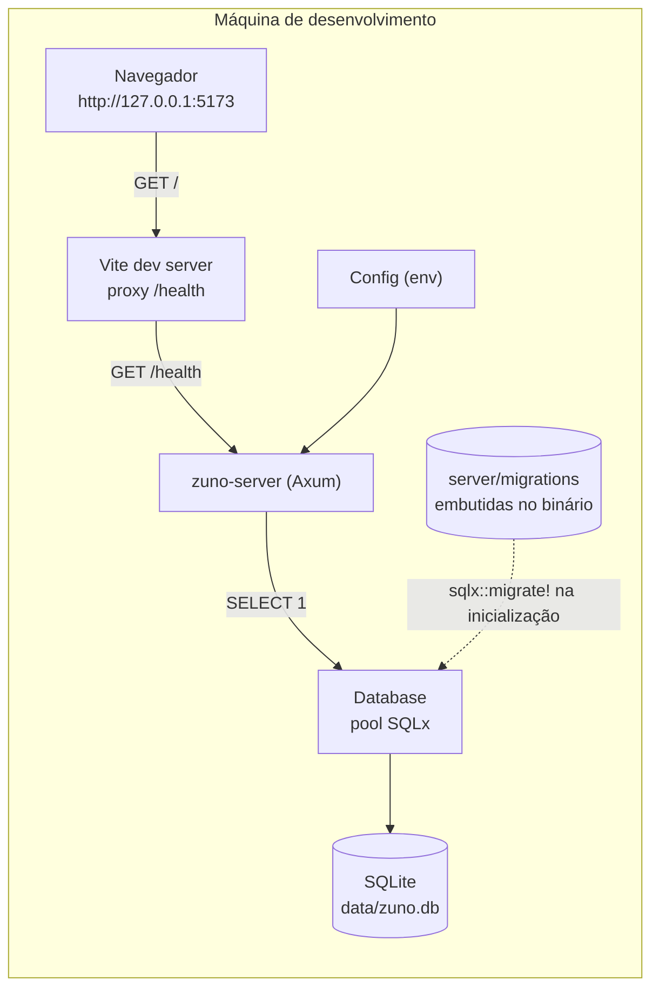
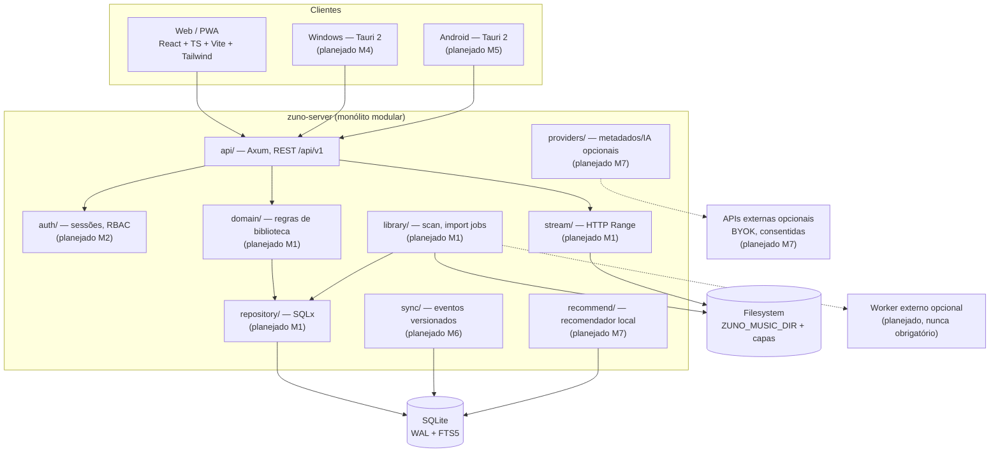

# Visão de arquitetura

Status deste documento: reflete o **marco M0 (fundação)** implementado no repositório. Tudo que pertence a M1+ está marcado explicitamente como **planejado**. Requisitos: [`PRD.md`](../../PRD.md) §5 e [`PLANO_AGENTE.md`](../../PLANO_AGENTE.md) §1–§2. Decisões registradas: [`docs/adr/`](../adr/README.md).

## 1. Resumo

O Zuno é um **monólito modular Rust** com um único executável de servidor (`zuno-server`), banco SQLite local e um frontend React/TypeScript que também será reaproveitado em Web/PWA, Windows (Tauri 2) e Android (Tauri 2). A meta é rodar em Raspberry Pi 3 com pouca memória, sem serviços externos obrigatórios.

O que existe hoje:

- `GET /health` — endpoint HTTP sem autenticação, usado para provar o caminho completo (cliente → Axum → SQLite).
- **Scanner de biblioteca** (`zuno-server scan`, M1a): indexa Opus, extrai tags/capas, detecta duplicatas e ausências
  e grava `scan_runs`/`scan_issues`. Ver [`docs/milestones/M1a.md`](../milestones/M1a.md) e [RFC-0001](../rfcs/0001-modelo-de-dominio-m1.md).
- Configuração tipada por variáveis de ambiente, pool SQLite com WAL e `foreign_keys=ON`, migrations embutidas no binário.
- Erros da API padronizados em `{ "code": "snake_case", "message": "texto" }`.
- Frontend `@zuno/web` com uma página de conectividade que consulta `/health` via proxy do Vite.

O que **não** existe: streaming HTTP com `Range` e API de biblioteca (M1b), upload/staging (M1c), autenticação/RBAC,
playlists, histórico, sync, recomendações, WebSocket, backup/restore e app Tauri compilado.

## 2. Arquitetura atual (M0)

Componentes reais do backend (`server/src`):

| Módulo | Papel | Depende de HTTP? |
|---|---|---|
| `main.rs` | Inicializa `tracing`, carrega `Config`, conecta o banco, sobe o listener TCP, trata `Ctrl+C` (graceful shutdown) | sim (bootstrap) |
| `lib.rs` | Reexporta a superfície pública (`Config`, `Database`, `AppState`, `build_router`) usada pelos testes de integração | — |
| `config.rs` | Lê `ZUNO_*` do ambiente, aplica padrões, valida `ZUNO_BIND_ADDR` e `ZUNO_DB_MAX_CONNECTIONS`; `Debug` redige a URL do banco | não |
| `db.rs` | Abre o pool, garante o diretório do arquivo, aplica WAL/`foreign_keys`/`busy_timeout`, roda migrations, expõe `health_check` | não |
| `error.rs` | `ApiError` → resposta JSON com `code`/`message`; erro interno é logado e nunca vazado ao cliente | sim (resposta) |
| `api/mod.rs` | `AppState`, `build_router`, `TraceLayer`, timeout de requisição e fallback JSON 404 | sim |
| `api/health.rs` | Handler de `GET /health` (200 `ok` / 503 `degraded`) | sim |

### 2.1 Fluxo de uma requisição `GET /health`

1. O cliente (navegador via proxy do Vite, `curl` ou cliente tipado) envia `GET /health` para `127.0.0.1:8080`.
2. `TraceLayer` registra a requisição; `TimeoutLayer` limita a duração e o middleware converte o timeout em `408` com corpo JSON.
3. O roteador entrega a requisição ao handler `health`, com `AppState` (pool + `started_at` + `version`).
4. O handler executa `SELECT 1` no pool.
   - Sucesso → `200` com `status: "ok"`, `database.status: "ok"`.
   - Falha → `503` com `status: "degraded"`, `database.status: "error"` (e um `warn` no log).
5. A resposta é serializada por `serde` a partir de `HealthResponse`/`DatabaseHealth`.
6. Rota inexistente cai no fallback e devolve `404 { "code": "not_found", ... }`.

Contrato detalhado: [`docs/api/openapi.yaml`](../api/openapi.yaml).

### 2.2 Fronteiras e regras de camada

- **Configuração → aplicação:** `Config` é imutável depois de carregada; nada lê `std::env` fora de `config.rs`.
- **HTTP → banco:** handlers recebem `AppState` e usam o pool; não abrem conexões próprias.
- **Erros:** o handler não monta JSON de erro manualmente — devolve `ApiError` e a conversão é única (`error.rs`).
- **Banco:** schema só existe via migrations (`server/migrations`); nenhum DDL em runtime.
- **Frontend → API:** o cliente tipado (`packages/api-client`) é a única porta de entrada; componentes não chamam `fetch` diretamente.

A camada de domínio isolada de Axum/SQLx (descrita na [ADR-0001](../adr/0001-backend-rust-monolito-modular.md)) ainda **não existe**: no M0 o único caso de uso é o healthcheck. Ela nasce no M1.

## 3. Arquitetura planejada (M1+)

Regras que valem para o desenho inteiro:

- O núcleo funciona **sem** worker externo, sem IA e sem internet.
- Áudio nunca entra no SQLite; só metadados e índices ([ADR-0004](../adr/0004-armazenamento-de-audio.md)).
- Todo endpoint futuro recebe um contexto explícito de autorização/ownership (M2+).
- Capacidades de reprodução variam por plataforma e são registradas na [matriz de áudio](audio-capabilities.md), não presumidas.

## 4. Decisão: bind local por padrão

O padrão é `ZUNO_BIND_ADDR=127.0.0.1:8080`. Motivos:

- O M0 não tem autenticação nem TLS; escutar em `0.0.0.0` exporia o healthcheck e qualquer rota futura à rede local sem controle.
- O acesso remoto é um recurso de produto (VPN/túnel, HTTPS, passkeys) planejado para milestones posteriores; não deve ser o padrão acidental.
- Mudar o bind é possível por variável de ambiente, mas é uma decisão consciente do operador, documentada em [`docs/installation/development.md`](../installation/development.md).

## 5. Princípios de baixo consumo (Raspberry Pi 3)

Sem números medidos ainda — metas numéricas de desempenho não são prometidas ([PRD](../../PRD.md) §1.1). As escolhas estruturais que sustentam o alvo:

- **Um processo** Rust (sem sidecar obrigatório), binário único com migrations embutidas.
- **Pool SQLite pequeno** (`ZUNO_DB_MAX_CONNECTIONS=4` por padrão, faixa aceita 1–32) e `busy_timeout` curto para evitar filas longas.
- **WAL + `synchronous=NORMAL`**: leituras concorrentes sem bloquear, com custo de fsync controlado.
- **Sem polling em background** no M0: nenhum job, timer ou varredura automática consome CPU em repouso.
- **Streaming por blocos** planejado (M1) em vez de carregar arquivos inteiros em memória.
- **Frontend estático** servido como arquivos; nada de renderização no servidor.
- **Logs estruturados** com filtro (`RUST_LOG`), evitando volume e custo de I/O.

Benchmarks reais no Pi 3 só serão publicados quando houver hardware de referência e medição registrada.

## 6. Armazenamento e dados

| Dado | Onde fica | Marco |
|---|---|---|
| Bytes de áudio | Filesystem (`ZUNO_MUSIC_DIR`) | M1 (diretório já configurável, ainda não usado) |
| Metadados de faixas/álbuns/artistas | SQLite | M1 |
| Capas/artwork | Filesystem + referência no SQLite | M1 |
| Migrations/histórico | `_sqlx_migrations` no SQLite | M0 (implementado) |
| Metadados operacionais | tabela `zuno_meta` | M0 (implementado) |
| Usuários, sessões, playlists, histórico | SQLite | M2 |
| Eventos de sync | SQLite | M6 |

Backup do M0 é equivalente a copiar `data/` com a aplicação parada; API de backup/restore é planejada para M3.

## 7. Observabilidade

- `tracing` + `tracing-subscriber` com `EnvFilter`; padrão `info,zuno_server=debug`.
- `tower-http::trace` registra requisições HTTP.
- Healthcheck é o sinal operacional atual; métricas de CPU/RAM/disco/streams estão planejadas (M3+), sempre **locais** e sem telemetria.
- Logs nunca devem conter segredos; `Config` já redige a URL do banco no `Debug`.

## 8. Referências

- [ADR-0001 — Backend Rust com monólito modular](../adr/0001-backend-rust-monolito-modular.md)
- [ADR-0002 — SQLite com migrations embutidas](../adr/0002-sqlite-e-migrations.md)
- [ADR-0003 — Arquitetura de clientes](../adr/0003-arquitetura-de-clientes.md)
- [ADR-0004 — Armazenamento de áudio](../adr/0004-armazenamento-de-audio.md)
- [ADR-0005 — Ferramentas do monorepo](../adr/0005-ferramentas-do-monorepo.md)
- [Threat model](../security/threat-model.md)
- [Matriz de capacidades de áudio](audio-capabilities.md)
- [Marco M0](../milestones/M0.md)
