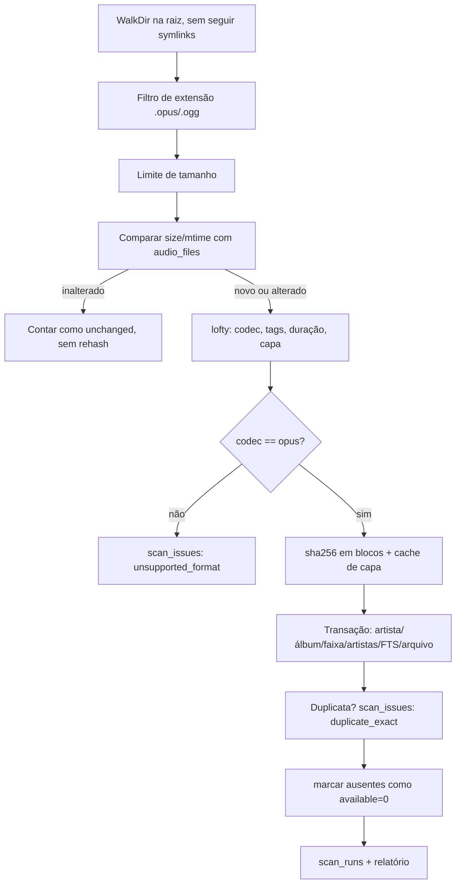

# RFC-0001 — Modelo de domínio e scanner da biblioteca (M1a)

- **Status:** Proposed → implementado no M1a
- **Milestone:** M1a
- **Data:** 2026-10-25
- **Issues relacionadas:** ZUNO-005 (scanner), ZUNO-006 (tags/capas)
- **ADRs relacionadas:** [ADR-0002](../adr/0002-sqlite-e-migrations.md), [ADR-0004](../adr/0004-armazenamento-de-audio.md), [ADR-0007](../adr/0007-opus-formato-canonico.md), [ADR-0009](../adr/0009-dependencias-e-ids-m1.md)

## 1. Resumo

Definir o schema mínimo da biblioteca musical, o formato de identificadores e o comportamento do scanner
incremental do M1a — sem API HTTP (M1b) e sem upload (M1c). A biblioteca é **somente Opus** (ADR-0007), o scan é
**somente leitura** e nada do usuário é movido ou apagado.

## 2. Motivação

O M0 entregou apenas `GET /health` e uma tabela de metadados. Para servir música é preciso representar artistas,
álbuns, faixas, arquivos e capas, com busca tolerante a acentos e histórico de varredura. O PRD §5.3 já propõe o
modelo; esta RFC o reduz ao necessário do M1a e resolve os detalhes que faltavam.

## 3. Escopo

**Dentro:** migration `0002`, tipos de domínio, repositório SQL, scanner (walk, filtro Opus, tags, hash, capas),
detecção de duplicatas/ausências, auditoria de scan, fixtures e testes.

**Fora:** endpoints de listagem/busca/stream (M1b), upload/staging (M1c), autenticação (M2), resize de capas (M1b),
transcodificação (não existe; ADR-0007), escrita de tags (M8).

## 4. Modelo de dados

```text
artists(id, name, normalized_name UNIQUE)
albums(id, title, normalized_title, album_artist_id?, release_year?, artwork_id?, UNIQUE(album_artist_id, normalized_title))
tracks(id, album_id?, title, normalized_title, disc_no?, track_no?, duration_ms?)
track_artists(track_id, artist_id, role, sort_order)  PK(track_id, artist_id, role)
artworks(id, relative_path UNIQUE, source, mime_type?, width?, height?, checksum)
audio_files(id, track_id, storage_id, relative_path UNIQUE, sha256, codec, container, bitrate?,
            sample_rate?, channels?, size_bytes, source_mtime, available, original_file_id?)
tracks_fts(track_id UNINDEXED, title, album, artists)  -- FTS5, unicode61 remove_diacritics 2
scan_runs(id, started_at, finished_at?, state, contadores..., error?)
scan_issues(id, scan_run_id, relative_path, code, detail?)
```

**Decisões e justificativas**

1. **Normalização separada de exibição.** `normalized_name`/`normalized_title` guardam a chave de identidade
   (minúsculas, espaços colapsados, acentos preservados). A busca sem acento é do tokenizer do FTS5.
2. **Álbum sem artista é permitido.** `UNIQUE(album_artist_id, normalized_title)` com `NULL` não colide no SQLite;
   dois álbuns “Greatest Hits” de artistas desconhecidos não se fundem indevidamente.
3. **FTS5 com manutenção explícita.** O conteúdo vem de três tabelas; usar tabela externa exigiria triggers e
   sincronização implícita. A aplicação apaga/reinsere a linha por `track_id` dentro da mesma transação da faixa.
4. **`audio_files.relative_path` é único**, mas não é identidade: `tracks.id`/`audio_files.id` são UUIDv7.
   Renomear/reorganizar o arquivo cria/atualiza a mesma faixa pelo caminho, sem perder IDs públicos.
5. **`source_mtime` + `size_bytes` evitam rehash** em rescans (importante em microSD do Pi 3). Se ambos mudaram,
   o arquivo é relido e o sha256 recalculado.
6. **Ausência nunca apaga.** `mark_missing_audio_files` só troca `available` 1→0; a linha, a faixa e o histórico ficam.
7. **Duplicata exata não é resolvida automaticamente.** Mesmo `sha256` em caminhos diferentes gera
   `duplicate_exact` em `scan_issues`; as duas linhas permanecem (resolução interativa no M2).
8. **Capas ficam em cache no filesystem** (`ZUNO_ARTWORK_DIR`), nomeadas por `sha256` do conteúdo, com escrita
   atômica (`.tmp` + rename). O banco guarda só a referência e o checksum.
9. **Auditoria de scan** (`scan_runs`/`scan_issues`) dá o “relatório claro” exigido quando um arquivo não é Opus.

## 5. Fluxo do scanner



Garantias de segurança: raiz canônica; link simbólico ignorado; `canonicalize` obrigatório e verificação de prefixo
contra a raiz; capa só é gravada no diretório de cache; nenhuma operação de escrita na árvore da biblioteca.

## 6. Códigos de problema (`scan_issues.code`)

| Código | Significado | Arquivo é indexado? |
|---|---|---|
| `unsupported_format` | extensão/codec diferente de Opus | não |
| `corrupt_file` | Opus ilegível | não |
| `too_large` | acima de `ZUNO_MAX_AUDIO_FILE_BYTES` | não |
| `symlink_skipped` | link simbólico | não |
| `outside_root` | caminho resolve para fora da raiz | não |
| `duplicate_exact` | mesmo sha256 de outro arquivo | **sim** (ambos mantidos) |
| `read_error` | falha de I/O | não |

## 7. Alternativas consideradas

| Alternativa | Prós | Contras | Decisão |
|---|---|---|---|
| Uma tabela `media` desnormalizada | menos joins | perde integridade de artista/álbum, dificulta FTS e playlists | recusada |
| FTS5 com `content=` externo + triggers | menos código de sync | triggers escondem lógica, difícil testar | recusada nesta fase |
| IDs inteiros sequenciais | simples, pequenos | enumeráveis, colidem entre dispositivos/importações | recusada (UUIDv7) |
| Hash em todo scan | simples | lê a biblioteca inteira a cada execução | recusada (mtime+size) |
| Mover arquivos para `Artista/Álbum` no scan | organização “bonita” | destrutivo sem consentimento | recusada (só no import/upload) |

## 8. Impacto

- **Dados:** nova migration aditiva (`0002`); rollback = restaurar backup do SQLite (M3) ou apagar o banco de
  desenvolvimento — nunca a música.
- **Desempenho:** scan é I/O-bound e roda em `spawn_blocking`; pool SQLite continua 4; sem transcodificação.
- **Segurança:** leitura estrita, sem escrita na biblioteca, sem exposição HTTP nova nesta entrega.
- **Compatibilidade:** nenhum endpoint existente muda; `zuno-server scan` é um subcomando novo.

## 9. Validação

Fixtures sintéticas Opus geradas com ffmpeg (`fixtures/audio/`) + testes de integração:
indexação de tags/capa, idempotência, duplicata exata, arquivo ausente (`available=0`), não-Opus reportado,
corrompido reportado, limite de tamanho, symlink/fora da raiz, FTS com e sem acento.

## 10. Rollback

1. `git revert` do commit do M1a (schema é aditivo, não remove nada).
2. Em desenvolvimento, apagar `data/zuno.db*` recria o banco; **nunca** apagar `ZUNO_MUSIC_DIR`.
3. Não há alteração em arquivos de música, portanto nenhum dado do usuário é afetado.
