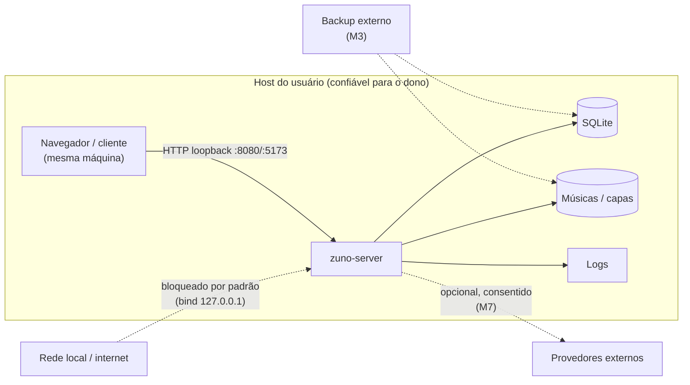

# Threat model — Zuno

Modelo de ameaças do Zuno, com foco no que **existe hoje** (M0) e no que está planejado por milestone. Requisitos: [`PRD.md`](../../PRD.md) §7 e §10; plano: [`PLANO_AGENTE.md`](../../PLANO_AGENTE.md) §5. Política de reporte: [`SECURITY.md`](../../SECURITY.md).

Este documento **não** é uma garantia de segurança e não substitui revisão especializada. Ele existe para que cada decisão nova seja avaliada contra as mesmas ameaças.

## 1. Escopo e premissas

**Dentro do escopo:** servidor `zuno-server`, banco SQLite, arquivos de música/capas, interface web, scaffolds Tauri, scripts de desenvolvimento e CI.

**Premissas:**

- A instância roda na rede pessoal do usuário, normalmente atrás de NAT, com bind em `127.0.0.1` por padrão.
- O host é confiável para o próprio dono, mas **não** é um ambiente de alta segurança (microSD, hardware doméstico).
- Não há autenticação no M0. Qualquer pessoa/processo com acesso ao loopback pode chamar a API.
- Não há exposição pública por padrão; acesso remoto (VPN/túnel, HTTPS, passkeys) é recurso planejado (M2+).
- Sem telemetria e sem serviços externos obrigatórios.

## 2. Ativos

| Ativo | Sensibilidade | Onde está | Marco |
|---|---|---|---|
| Arquivos de música do usuário | alta (direitos autorais + coleção pessoal) | filesystem (`ZUNO_MUSIC_DIR`) | M1 |
| Metadados da biblioteca (faixas, álbuns, caminhos) | média | SQLite | M1 |
| Playlists, favoritos | média | SQLite | M2 |
| Histórico de audição | **alta** (comportamento pessoal) | SQLite | M2 |
| Credenciais: hashes de senha, refresh tokens, passkeys | crítica | SQLite | M2 |
| Chaves BYOK de provedores de IA/metadados | crítica | fora do repositório; referência no banco | M7 |
| Banco de dados e backups | alta | filesystem / destino de backup | M0 (arquivo) / M3 (backup) |
| Logs e diagnósticos | média (podem conter caminhos e IPs) | stderr/arquivo | M0 |
| Disponibilidade do servidor | média | host | M0 |

## 3. Atores

| Ator | Confiança | Observações |
|---|---|---|
| Dono/administrador | alta | Instala, configura, faz backup; controla o host |
| Moderador | média | Corrige metadados/capas e aprova importações; **não** é superusuário |
| Ouvinte convidado | média | Acessa apenas seus próprios dados |
| Processo local não autorizado | baixa | Sem auth no M0, tem acesso total via loopback |
| Página web maliciosa no navegador do operador | baixa | Pode tentar requisições ao loopback (CSRF/DNS rebinding) |
| Atacante de rede (remoto) | baixa no M0 | Só relevante se o bind for alterado ou houver túnel |
| Dependência comprometida | baixa | Vetor de supply chain em Rust/npm |
| Provedor externo opcional | baixa | Recebe apenas o que o usuário autorizar (M7) |
| Atacante com acesso físico ao dispositivo | baixa/média | Pode ler o disco se não houver criptografia de volume |

## 4. Fronteiras de confiança

1. **Browser ↔ servidor local** — fronteira mais atacada no M0: qualquer origem no navegador pode tentar alcançar `127.0.0.1`.
2. **Servidor ↔ banco/arquivos** — o processo do servidor controla caminhos e dados.
3. **Host ↔ operador** — quem tem root/usuário do SO lê tudo; não há proteção criptográfica contra o dono do host.
4. **Instância ↔ provedores externos** — só existe se o usuário habilitar (M7).
5. **Aplicativo ↔ atualização/release** — integridade de binários e checksums (M4+).

## 5. Ameaças (STRIDE) e mitigações

Legenda de status: **implementado (M0)** = já no código atual; **planejado** = previsto para o milestone indicado.

| ID | Categoria | Ameaça | Ativo | Controle atual (M0) | Mitigação planejada |
|---|---|---|---|---|---|
| T-01 | Spoofing | Página maliciosa no navegador acessa `127.0.0.1:8080` (CSRF / DNS rebinding) e obtém dados da API | dados da API | Bind em loopback; nenhum endpoint sensível existe no M0 | Validação de `Origin`/`Host`, cookies `SameSite`, CSRF token e auth obrigatória (M2) |
| T-02 | Spoofing | Atacante se passa por usuário (credenciais fracas, sessão roubada) | contas, histórico | Não aplicável (sem auth) | Argon2id, refresh tokens rotativos, rate limiting, passkeys (M2) |
| T-03 | Spoofing | Cliente falso se conecta ao Zuno Connect e envia comandos | sessões de reprodução | Não aplicável | Autenticação por dispositivo + autorização por sessão (M6) |
| T-04 | Tampering | Modificação indevida de dados via SQL injection | banco | SQLx com queries parametrizadas; migrations estáticas; sem DDL em runtime | Validação de entrada, testes de contrato e revisão por endpoint (M1+) |
| T-05 | Tampering | Alteração/movimentação de arquivos de música por path traversal ou symlink escape | biblioteca | `ZUNO_MUSIC_DIR` existe mas não é usado | Canonicalização de caminho, recusa de symlink fora da raiz, staging fora do diretório servido (M1) |
| T-06 | Tampering | Migration mal aplicada ou schema divergente | metadados | Migrations embutidas e idempotentes; versão registrada em `_sqlx_migrations` | Teste de migração + restore, backup antes de schema destrutivo (M3) |
| T-07 | Repudiation | Ação administrativa destrutiva sem registro de quem fez | biblioteca, playlists | Não há ações administrativas no M0 | Tabela `audit_events` com ator/ação/alvo e detalhe redigido (M2/M3) |
| T-08 | Information disclosure | Vazamento de segredos em repositório, logs ou issues | credenciais | Nenhum segredo versionado; config só por env; `.env` no `.gitignore`; `Debug` de `Config` redige a URL do banco | Redação de logs, secret scanning no GitHub, revisão de PR (contínuo) |
| T-09 | Information disclosure | Healthcheck revela versão/estado interno | operação | Exposição mínima: `service`, `version`, `uptime_seconds`, estado do banco | Manter mínimo; não adicionar detalhes internos ao `/health` (contínuo) |
| T-10 | Information disclosure | Histórico de audição visível para outros usuários ou para telas administrativas | histórico | Não aplicável (sem histórico) | Isolamento por usuário, autorização por recurso, UI sem agregação indevida (M2) |
| T-11 | Information disclosure | Backup remoto em claro ou legível por terceiros | banco, arquivos | Sem backup implementado | Criptografia obrigatória em backup remoto, verificação de integridade (M3) |
| T-12 | Information disclosure | Envio inadvertido de histórico/arquivos a provedor externo | histórico | Nenhuma integração externa implementada | Veto por usuário (`allow_cloud_history=false`), minimização, cache e circuit breaker (M7) |
| T-13 | Denial of service | Requisições abusivas esgotam pool/CPU (inclusive via loopback) | disponibilidade | Pool pequeno (4), `acquire_timeout`/`busy_timeout` de 5 s, timeout de requisição de 10 s | Rate limiting persistente e limites por endpoint (M2); limites de upload (M1) |
| T-14 | Denial of service | Disco cheio (microSD) corrompe escrita do banco ou importação | dados, disponibilidade | SQLite WAL com `busy_timeout`; diretório criado automaticamente | Checagem de espaço antes de importar, quarentena e recuperação de jobs (M1) |
| T-15 | Elevation of privilege | Endpoint futuro sem verificação de ownership (IDOR) | dados de outros usuários | Sem endpoints além de `/health` | Contexto explícito de autorização por handler + testes de isolamento (M2) |
| T-16 | Elevation of privilege | Moderador obtém permissões de administrador | biblioteca, backups | Sem RBAC no M0 | RBAC mínimo, permissões explícitas negadas por padrão (M2) |
| T-17 | Supply chain | Dependência Rust/npm vulnerável ou comprometida | todo o sistema | `cargo audit` + `npm audit --audit-level=high` no CI; lockfiles versionados; dependências mínimas | Revisão de novas dependências, atualização periódica, SBOM [PROPOSTO] |
| T-18 | Integridade de release | Binário/atualização adulterada | clientes, servidor | Não há release no M0 | Checksums/assinatura e verificação antes de aplicar atualização (M4+) |

## 6. Controles já implementados no M0

Verificáveis no código atual:

| Controle | Onde |
|---|---|
| Bind padrão em `127.0.0.1:8080`, nunca `0.0.0.0` | `server/src/config.rs` (`DEFAULT_BIND_ADDR`) |
| Configuração apenas por variáveis de ambiente; nenhum segredo no repositório | `server/src/config.rs`, `.env.example` |
| URL do banco redigida em logs de `Debug` | `server/src/config.rs` |
| Migrations embutidas no binário, aplicadas na inicialização, sem DDL em runtime | `server/src/db.rs`, `server/migrations/` |
| SQLite com WAL, `foreign_keys=ON`, `synchronous=NORMAL`, `busy_timeout` | `server/src/db.rs` |
| Pool limitado (padrão 4, faixa 1–32) e timeouts de aquisição/requisição | `server/src/config.rs`, `server/src/db.rs`, `server/src/api/mod.rs` |
| Erro interno nunca vazado ao cliente (log + mensagem genérica) | `server/src/error.rs` |
| Fallback JSON para rotas inexistentes (sem stack trace) | `server/src/api/mod.rs` |
| `unsafe_code = "forbid"` no workspace; clippy com `-D warnings` no CI | `Cargo.toml`, `.github/workflows/ci.yml` |
| Auditoria de dependências (`cargo audit`, `npm audit --audit-level=high`) | `.github/workflows/security.yml` |
| Sem telemetria, analytics ou SDK de rastreamento | dependências de `Cargo.toml` e `package.json` |
| `.gitignore` exclui `data/`, `*.db`, `*.db-wal`, `.env` | `.gitignore` |
| Permissões mínimas do Tauri declaradas no scaffold | `apps/desktop/src-tauri/capabilities/default.json` |

## 7. Riscos abertos (aceitos ou pendentes)

1. **Sem autenticação no M0.** Qualquer processo local acessa a API. Aceitável enquanto o único endpoint é o healthcheck e o bind é loopback; deixa de ser aceitável no M2.
2. **Sem rate limiting.** Requisições repetidas ao loopback podem consumir CPU; impacto limitado hoje.
3. **Sem auditoria de ações.** Não há como provar quem alterou o quê (não há ações mutáveis ainda).
4. **Banco e arquivos em claro no disco.** Quem controla o host lê tudo. O PRD exige explicitar esse limite ao usuário; criptografia em repouso não está no escopo do MVP.
5. **Sem backup/restore implementado.** Perda de microSD é perda total. Documentado como pendência de M3.
6. **Sem validação de `Origin`/`Host`.** Relevante quando existirem endpoints com dados; hoje só há `/health`.
7. **Licença indefinida.** Restringe reuso e contribuições; não é risco técnico, mas de governança ([ADR-0006](../adr/0006-licenca-pendente.md)).
8. **Sem teste em hardware real (Pi 3).** Comportamento sob microSD lento e energia instável ainda não foi medido — nenhuma métrica é publicada antes de medição real.

## 8. Fora de escopo

- Ataques físicos, engenharia social e comprometimento total do host.
- Segurança de serviços de terceiros usados opcionalmente (provedores de IA/metadados).
- Garantias criptográficas contra o administrador do servidor (limite de privacidade declarado no produto).
- Conformidade regulatória específica (LGPD/GDPR) — a avaliar antes de qualquer release público amplo.

## 9. Revisão

Revisar este documento ao final de cada milestone e sempre que:

- um novo endpoint ou superfície de rede for adicionado;
- uma integração externa for habilitada;
- o modelo de autenticação/autorização mudar;
- um novo tipo de dado pessoal for armazenado.

Mudanças relevantes de arquitetura de segurança exigem ADR. Reporte vulnerabilidades conforme [`SECURITY.md`](../../SECURITY.md).
